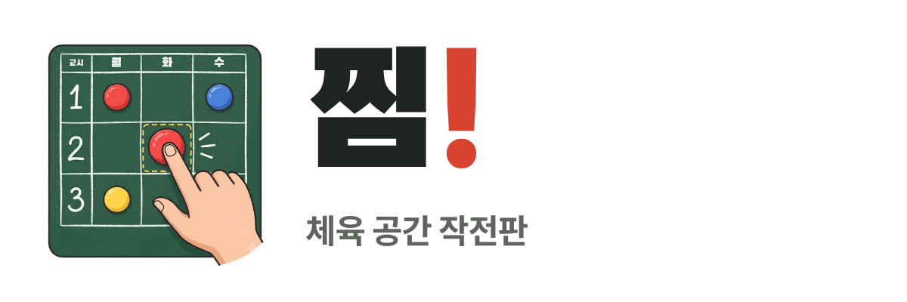

# 찜! Zzim



학교 강당·운동장·체육 관련 교실을 함께 쓰는 체육 공간 예약판입니다. 체육 수업이 1순위이고, 체육 선생님이 비운 시간과 원래 빈 시간은 다른 반이 신청해서 씁니다.

만든 사람: 음악적체육인

## 화면

| 주소 | 누가 | 하는 일 |
| --- | --- | --- |
| `index.html` | 선생님 (구글 로그인) | 학교 코드로 들어와 예약판 보기, 신청·예약, 체육 칸 비우기, 우천 이동 |
| `index.html?demo` | 누구나 (로그인 없음) | 지어낸 학교(햇살초등학교)가 채워진 체험 모드. 눌러 본 것은 그 기기에만 남음 |

## 규칙

- 체육 시간표를 한 번 넣어 두면 매주 체육 칸이 자동으로 잡힙니다 (1순위).
- 체육 선생님이 교실 수업을 하는 날에는 "이 시간 비우기"를 눌러 그 칸을 내놓습니다.
- 빈 칸은 사용 전 수업일 오후 3시까지 신청을 받습니다 (월요일 칸은 금요일 오후 3시).
- 여러 반이 신청하면 이번 달에 덜 쓴 반이 먼저, 같으면 추첨입니다. 추첨은 누가 열어도 같은 결과가 나옵니다.
- 마감 뒤 남은 칸은 먼저 누르는 반이 바로 예약합니다.
- 비 오는 날에는 운동장 체육 수업을 실내로 옮기며 그 칸을 먼저 차지합니다. 예약이 밀려난 반과 체육을 듣는 반 담임 선생님께 안내 알림이 갑니다.
- 점심시간에는 '점심시간 신청'을 켠 장소(기본: 강당)를 담임 선생님만 반 이름으로 신청합니다. 정리와 안전 지도는 신청한 담임 선생님이 맡고, 사용 횟수는 수업 시간과 따로 셈합니다.
- 점심시간은 요일마다 신청할 수 있는 학년을 정할 수 있습니다 (예: 5·6학년만, 요일별 순번).
- 스포츠클럽 활동·행사 등으로 쓸 수 없는 칸은 체육 선생님이 사유와 함께 막아 둡니다 (하루만 또는 매주).
- 장소는 강당·운동장이 기본이고, 학교 사정에 맞게 더하거나 뺄 수 있습니다.

## 들어오기

1. 구글 계정으로 로그인합니다.
2. 학교 코드를 넣습니다. 처음이면 "우리 학교 처음 만들기"로 만들고, 만든 사람이 관리자가 됩니다.
3. 처음 온 선생님은 이름·구분·학년·반을 한 번 적습니다.
4. 우리 학교 선생님이 아니면 체육 선생님이 설정에서 "내보내기"로 정리합니다.

## 파일

- `index.html` 화면·규칙·저장이 모두 들어 있는 한 장짜리 앱. 맨 위 `FIREBASE_CONFIG` 에 파이어베이스(zzim-pe) 설정이 들어 있습니다. 주소 뒤에 `?demo` 를 붙이면 체험 모드로 열립니다.
- `firebase-rules.txt` 파이어베이스 설정 순서와 Firestore 보안 규칙
- `icons/`, `og.jpg`, `manifest.webmanifest` 아이콘·카톡 공유 그림·홈 화면 추가 설정
- `tests/` 시험 파일

## 시험

```
node tests/check.mjs              # 코드 검사: 문법, 단추가 부르는 기능, 판 번호
python3 tests/e2e_demo.py         # 전체 시험 1: 체험 모드로 신청·마감·추첨·우천·설정 흐름을 밟아 봄
python3 tests/e2e_login.py        # 전체 시험 2: 가짜 파이어베이스로 구글 로그인·등록·내보내기 흐름을 밟아 봄
```

전체 시험은 playwright(파이썬)와 크롬이 필요합니다. 크롬 위치는 `CHROME` 환경 변수로 바꿀 수 있습니다.
단순 수정(글귀·색·여백)은 코드 검사만, 기능 수정은 세 가지를 모두 돌립니다.

## 사용 조건 · 저작권

이 프로그램과 로고·안내 글의 저작권은 **음악적체육인**에게 있습니다. 자세한 내용은 [LICENSE](LICENSE) 파일을 봐 주세요.

| 이렇게 쓸 수 있어요 (무료) | 이렇게는 쓸 수 없어요 |
|---|---|
| 선생님이 웹앱으로 학교 체육 공간 예약에 쓰기 | 프로그램이나 그 일부를 판매하거나 유료 서비스·앱·자료·연수에 넣기 |
| 학교·교사가 교육 목적으로 쓰기 | 광고를 붙여 배포·운영하기 |
| 출처를 밝히고 돈을 받지 않고 주소 나누기 | 저작자 표시·사용 조건을 지우거나 자기가 만든 것처럼 배포하기 |
|  | 코드를 복사해 같은 기능의 다른 서비스로 따로 운영하기 |
